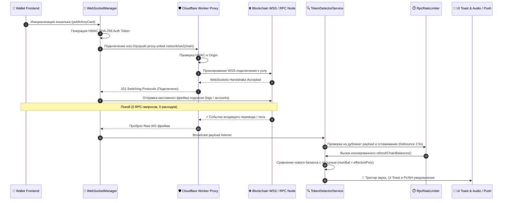

# 📡 Модуль Token Detector & WebSocket Notification System

Комплексная архитектурная документация системы обнаружения токенов, WebSocket-проксирования, управления реальными уведомлениями о транзакциях и защиты от перегрузки RPC для 15 поддерживаемых блокчейнов.

---

## 📑 Содержание
1. [Обзор архитектуры](#1-обзор-архитектуры)
2. [Компоненты системы](#2-компоненты-системы)
3. [Схема работы (Mermaid Workflow)](#3-схема-работы-mermaid-workflow)
4. [Карта подключения 15 блокчейнов](#4-карта-подключения-15-блокчейнов)
5. [Принцип работы Zero Polling (Event-Driven)](#5-принцип-работы-zero-polling-event-driven)
6. [Безопасность и HMAC-аутентификация](#6-безопасность-и-hmac-аутентификация)
7. [Отказоустойчивость (Retry, Failover & Safe Disable)](#7-отказоустойчивость-retry-failover--safe-disable)
8. [Защита от спама и троттлинг (RpcRateLimiter)](#8-защита-от-спама-и-троттлинг-rpcratelimiter)
9. [Руководство по тестированию и верификации](#9-руководство-по-тестированию-и-верификации)

---

## 1. Обзор архитектуры

Модуль предназначен для мгновенного обнаружения входящих транзакций и изменений балансов пользователя на 15 блокчейн-сетях. 

Главные принципы модуля:
- **Zero Polling (Нулевой фоновый опрос)**: Никаких фоновых интервалов `setInterval`, тратящих платные RPC Compute Units (CUs).
- **Event-Driven notifications**: Запросы балансов вызывются строго по факту поступления событий из WebSocket-потока или нативного стрима.
- **HMAC Secure Gateway**: Защищенное WebSocket-проксирование через Cloudflare Worker с защитой от использования сторонними доминами.
- **Auto-Failover**: Автоматическое мгновенное переключение на резервные узлы (PublicNode, dRPC, GetBlock) при сбоях первичных нод.

---

## 2. Компоненты системы

```
src/modules/token-detector/
├── services/
│   ├── WebSocketManager.ts      # Менеджер WSS-соединений, HMAC-авторизации, авто-реконнектов
│   ├── TokenDetectorService.ts  # Детектор событий транзакций, балансовый дельта-трекер, уведомления
│   └── RpcRateLimiter.ts        # Ограничитель частоты RPC-запросов (Debounce, Cooldown, Deduplication)
├── components/                  # UI-компоненты оверлеев и тостов нотификаций
└── README.md                    # Архитектурная документация модуля
```

---

## 3. Схема работы (Mermaid Workflow)



---

## 4. Карта подключения 15 блокчейнов

| Блокчейн | Тип сети | Первичный маршрут WSS | Резервный маршрут (Failover) | Метод подписки (Frame) |
| :--- | :--- | :--- | :--- | :--- |
| **Ethereum** | EVM | Alchemy (`eth-mainnet.g.alchemy.com`) | PublicNode (`ethereum-rpc.publicnode.com`) | `eth_subscribe` (Transfer logs) |
| **Polygon** | EVM | Alchemy (`polygon-mainnet.g.alchemy.com`) | PublicNode (`polygon-bor-rpc.publicnode.com`) | `eth_subscribe` (Transfer logs) |
| **Arbitrum** | EVM | Alchemy (`arb-mainnet.g.alchemy.com`) | PublicNode (`arbitrum-one-rpc.publicnode.com`) | `eth_subscribe` (Transfer logs) |
| **Base** | EVM | Alchemy (`base-mainnet.g.alchemy.com`) | PublicNode (`base-rpc.publicnode.com`) | `eth_subscribe` (Transfer logs) |
| **Avalanche** | EVM | Alchemy (`avax-mainnet.g.alchemy.com`) | PublicNode (`avalanche-c-chain-rpc.publicnode.com`) | `eth_subscribe` (Transfer logs) |
| **BNB Chain** | EVM | PublicNode (`bsc-rpc.publicnode.com`) | dRPC (`lb.drpc.org/ogws?network=bsc`) | `eth_subscribe` (Transfer logs) |
| **Katana** | EVM | dRPC (`katana.drpc.org`) | PublicNode Backup | `eth_subscribe` (Transfer logs) |
| **Coti** | EVM | Coti Node (`mainnet.coti.io/ws`) | PublicNode Backup | `eth_subscribe` (Transfer logs) |
| **Solana** | Non-EVM | Dedicated GetBlock WSS (`solana-websocket.worker.united.network`) | PublicNode (`solana-rpc.publicnode.com`) | `logsSubscribe` + `accountSubscribe` (19 ATA адресов) |
| **XRP** | Non-EVM | XRPL Cluster (`xrplcluster.com`) | Public XRPL WS | `subscribe` (`accounts: [addr]`) |
| **Bitcoin** | Non-EVM | Mempool.space (`mempool.space/api/v1/ws`) | Public Mempool WS | `track-address` (`[addr]`) |
| **Tron** | Non-EVM | dRPC (`tron.drpc.org`) | TronGrid (`api.trongrid.io/sub`) | Native Subscription / dRPC |
| **Ton** | Non-EVM | dRPC (`ton.drpc.org`) / TonAPI WSS | TonCenter HTTP Client | `subscribe-account` / Native SDK |
| **Venom** | Native | Native JRPC (`jrpc.venom.foundation/rpc`) | Everscale Client SDK | Native Subscriber (`ProviderRpcClient`) |
| **Canton** | Native | Canton Ledger API v2 (`139.59.133.50:22975`) | HTTP Streaming (`/v2/updates`) | Ledger API v2 Contracts State |

---

## 5. Принцип работы Zero Polling (Event-Driven)

Приложение **не производит регулярный фоновый опрос** RPC-узлов. Опрос предотвращён на архитектурном уровне:

1. **EVM & Utxo Стримы**: Сокет запрашивает у ноды уведомление только по теме передачи токенов (`topics: [TransferTopic, null, userPaddedAddress]`). Все остальные транзакции блокчейна игнорируются на уровне сервера ноды.
2. **Балансовый дельта-трекер**:
   Когда событие получено, `TokenDetectorService` выполняет вычисление дельты:
   $$\Delta = \text{Balance}_{\text{new}} - \text{Balance}_{\text{previous}}$$
   Если $\Delta > 0.000001$, генерируется событие `transactionReceived`.
3. **Обновление только одной монеты**: Для EVM-сетей при получении точечного лога контракта запрашивается только баланс этого конкретного контракта (`processEvmToken`), предотвращая полную перезагрузку всех токенов.

---

## 6. Безопасность и HMAC-аутентификация

Для защиты прокси-воркера Cloudflare от несанкционированного доступа третьих лиц используется HMAC SHA-256 подпись:

$$\text{Token} = \text{HMAC-SHA256}\left(\text{Secret}, \text{TimestampBucket} + ":" + \text{Address}_{\text{lowercase}}\right)$$

- **Окно валидности**: 2 минуты (`Math.floor(Date.now() / 60000)`).
- **Проверка Origin**: Разрешены только валидные домены (`*.united.network`, `*.samekey.dev`, `localhost`).

---

## 7. Отказоустойчивость (Retry, Failover & Safe Disable)

Для исключения бесконечных циклов переподключения в `WebSocketManager.ts` реализован строгий протокол повторов:

1. **Экспоненциальная задержка повторов**:
   - Попытка 1: 1000 мс
   - Попытка 2: 2000 мс
   - Попытка 3: 4000 мс
2. **Окончательное отключение (Permanent Disable)**:
   При исчерпании `MAX_RECONNECT_ATTEMPTS = 3` сеть заносится в реестр `disabledChains.add(chain)` и новые попытки соединения блокируются до перезапуска сессии кошелька.
3. **Авто-переключение (Fallback Switching)**:
   Если первичный сервер возвращает ошибку или недоступен, воркер автоматически проксирует поток на Backup PublicNode / dRPC.

---

## 8. Защита от спама и троттлинг (RpcRateLimiter)

Сервис `RpcRateLimiter` защищает клиент от лавины запросов:
- **Debounce**: Задержка 2500 мс для объединения пачки фреймов в 1 запрос.
- **Cooldown**: Минимальный интервал 5000 мс между повторными запросами к одной сети.
- **Deduplication**: Дедупликация хэшей фреймов `sha256(chain + payload)` в окне 10 секунд.

---

## 9. Руководство по тестированию и верификации

### А. Локальная проверка линтера и типов:
```bash
make lint
```

### Б. Проверка подключения WebSocket-нод в консоли браузера:
1. Запустите приложение: `make dev`.
2. Откройте Developer Tools (Console).
3. Убедитесь в наличии зелёных статусов для подписок:
   - `[WebSocketManager] ✅ Connected to Ethereum WS ...`
   - `[TokenDetectorService] ✅ Subscription confirmed on Solana: ID 9588`
   - `[CantonOnboardingOverlay] API Response isOnBoarded: true`

### В. Автоматическое тестирование автономных сокетов:
Выполните запуск Node.js скрипта проверки всех эндпоинтов:
```bash
node ./scratch/test_chains_ws.mjs
```
